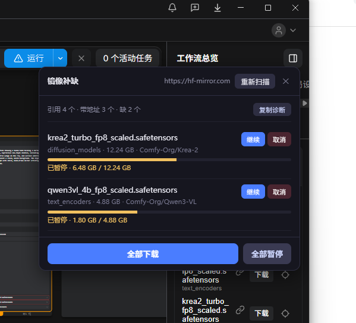

# ComfyUI-ModelMirror · 镜像下载自动补缺

> 由 @痒局长 制作 · [B 站](https://space.bilibili.com/322892) · [Comfy Registry](https://registry.comfy.org/publishers/ainjuzen/nodes/comfyui-modelmirror)

> 缺模型时，一键从镜像补齐。**不改官方任何文件，升级不碎。**

打开一个别人分享的工作流，右侧跳出「缺失模型」——点官方的「下载」，它直连
`huggingface.co`，在国内基本下不动。

这个扩展在同一个位置加一个「镜像补缺」按钮：自动扫出缺什么、按文件名去镜像上找到
官方仓库、断点续传下到正确的目录。



---

## One-liner (EN)

**ComfyUI shows "missing models" when you open a shared workflow, and its download button
goes straight to `huggingface.co` — which is unreachable for many users.**

This extension adds a **Mirror Fetch** button next to it: it detects the missing model files,
resolves each to its official HF repo through a configurable mirror, and downloads them into
the correct `models/<type>/` folder — with pause / resume / retry / concurrency limit, and
**without patching ComfyUI itself** (safe across upgrades).

```bash
cd ComfyUI/custom_nodes
git clone https://github.com/AinJuZen/ComfyUI-ModelMirror.git
# restart ComfyUI — no pip install needed
```

Everything below is in Chinese, which is the primary audience. If you need English docs,
open an issue and I'll write them.

---

## 安装

**要求**：ComfyUI ≥ 0.3.x（含 Desktop 版）。纯标准库，无额外依赖。

### 方式 A · 一行命令（推荐）

```bash
comfy node install comfyui-modelmirror
```

**没有 `comfy` 命令？先装一次：**

```bash
pip install comfy-cli
```

### 方式 B · ComfyUI-Manager

**取决于你用的 Manager 版本：**

```
Manager 4.x（pip 版，读 api.comfy.org）
    → 已发布到 Registry，状态 Active，缓存刷新后可搜到

Manager 3.x（custom_nodes 版，读 GitHub 的 custom-node-list.json）
    → 目前搜不到，正在提交收录 PR
    → 在那之前请用方式 A（一行命令）或方式 C（ZIP）
```

**不确定自己是哪个版本？直接看方式 A——一行命令，不需要 Manager。**

### 方式 C · 下载 ZIP（不用命令行，也不用 Manager）

**① 仓库首页 → 绿色 `Code` 按钮 → `Download ZIP`**

```
https://github.com/AinJuZen/ComfyUI-ModelMirror
```

**② 解压，得到 `ComfyUI-ModelMirror-main`，改名成 `ComfyUI-ModelMirror`（去掉 `-main`）**

**③ 整个文件夹放进 ComfyUI 的 `custom_nodes` 目录**

```
便携版     <ComfyUI_windows_portable>/ComfyUI/custom_nodes/
桌面版     <ComfyUI-Installs>/<实例>/ComfyUI/custom_nodes/
```

**④ 重启 ComfyUI**

---

## 使用

1. 打开一个缺模型的工作流
2. 右侧「缺失模型」面板 → 「全部下载」下面多了 **「镜像补缺」**
3. 点开 → 自动列出缺哪些、大小、来源仓库
4. 点「下载」或「全部下载」

面板里每个文件支持：**下载 / 暂停 / 继续 / 取消 / 重试**，带进度条、速度、剩余时间。

---

## 特性

| | |
|---|---|
| 自动识别缺失 | 从当前工作流里扫出被引用的模型文件 |
| 按文件名反查仓库 | 不依赖 ComfyUI 内部数据结构，官方改版也不影响 |
| 官方仓库优先 | 优先匹配 `Comfy-Org/*`，避免下到第三方同名文件 |
| 目录自动判定 | 按**节点控件名**决定存到 `models/<type>/`（和原生一致） |
| 断点续传 | 中断、暂停、重启都不丢进度 |
| 完整性校验 | 下完比对字节数，半截文件不会冒充成品 |
| 并发上限 | 默认 5 个，其余排队 |
| 可配置镜像端点 | 环境变量 `HF_MIRROR` |
| 不修改官方文件 | 纯扩展，升级不碎 |

---

## 工作原理

**问题**：官方「缺失模型」面板的下载走 Electron 主进程直连 `huggingface.co`，
URL 写死在模板的节点属性里，没有任何镜像配置项。

**做法**：

```
扫出缺失文件名
   ↓
去镜像 API 搜（先全名，搜不到退到前缀，如 krea2_xxx → krea2）
   ↓
官方 Comfy-Org 仓库优先，逐个比对 basename
   ↓
拿到 url + 仓库路径段 + 真实大小
   ↓
按"哪个节点的哪个控件要它"决定目录，下载到 models/<type>/
```

**为什么不从工作流里抠 URL**：
不同 ComfyUI 版本把 `properties.models` 放在不同位置（graph / object_info /
workflowManager），抠了三个版本都不稳。**改成"按文件名反查"之后，只依赖
"文件叫什么名字"——这件事官方不会改。**

---

## 配置

| 环境变量 | 默认 | 说明 |
|---|---|---|
| `HF_MIRROR` | `https://hf-mirror.com` | 模型下载镜像端点 |
| `MIRROR_FETCH_CONCURRENCY` | `5` | 同时下载数上限 |

---

## 已知限制（请先读）

```
① 只能找到公开仓库里的文件
   私人上传、非公开仓库找不到 —— 面板会显示"无地址"

② 同名不同仓库可能匹配到第三方
   优先 Comfy-Org，但无法 100% 保证

③ 速度取决于镜像
   实测 0.2 ~ 55 MB/s，按时段波动很大，不是本扩展的问题

④ civitai 的模型没有国内镜像
   这类文件本扩展无能为力，需要代理

⑤ 改 .py 后必须重启 ComfyUI
   改 .js 只需刷新页面 —— 这是 ComfyUI 的加载机制，不是本扩展的
```

---

## 常见问题

**Q：点了「镜像补缺」没反应？**
按 `Ctrl + F5` 强刷。如果还不行，看控制台有没有 `[mirror-fetch]` 报错。

**Q：按钮出现了但列表是空的？**
当前工作流没有引用任何模型文件，或者引用方式本扩展识别不了
（点「复制诊断」把结果发 issue）。

**Q：下载失败，提示"下载不完整"？**
镜像中途断流。点「重试」，会从断点继续，不会重下。

**Q：能不能不用镜像、直接下？**
可以，`HF_MIRROR=https://huggingface.co` 即可（前提是你能连上）。

---

## 兼容性 / Tested against

**开发和测试所用的确切环境**（不是"理论上支持"，是实际跑过的那一套）：

| 项 | 版本 |
|---|---|
| **ComfyUI** | **0.44.2** |
| **ComfyUI 前端** `comfyui-frontend-package` | **1.57.6** |
| 工作流模板 `comfyui-workflow-templates` | 0.11.103 |
| ComfyUI Desktop（Electron 外壳） | 1.1.9 |
| Python | 3.13.12 |
| PyTorch | 2.12.1+cu130 |
| OS | Windows 11（win32） |

**本扩展是在 ComfyUI Desktop + 本地实例上开发和实测的**，
同一套代码在没有 Electron 外壳的普通 ComfyUI（便携版/手动安装）上也应当可用——
因为用到的只有标准扩展接口（`PromptServer.instance.routes` + `WEB_DIRECTORY`）。

### 怎么查你自己的版本

界面里：**设置 → 关于 / About**，或者：

```bash
curl http://127.0.0.1:8188/system_stats
```

**报 bug 时请附上 `comfyui_version` 和 `required_frontend_version` 两个值。**

### 版本风险点

**本扩展跟 UI 的耦合只有两处，任何一处变了都可能失效：**

```
① 注入点：靠文案匹配"全部下载 / Download All"以及"缺失模型 / Missing Models"
   → 官方改文案或改面板结构，按钮就挂不上去
   （已做 12 种语言匹配 + 两级兜底 + 浮动按钮，但不能保证永远有效）

② 目录约定：靠节点控件名（ckpt_name / unet_name / clip_name …）判定存哪
   → 官方新增节点类型时，需要往 WIDGET_DIR 表里补一行
```

**后端几乎不受影响**——它只依赖"文件名"和"models 目录"，这两件事官方不会改。

**所以升级 ComfyUI 后如果按钮消失，大概率只是 ①，改几行 JS 就能修，不需要重启。**

---

## 免责声明

```
⚠️ 本扩展只做一件事：把模型文件从镜像下载到正确的目录。
   不绕过任何访问控制，不提供、不分发任何模型内容。

⚠️ 镜像端点可配置，其可用性与速度取决于第三方镜像服务，
   与本项目无关，也不构成任何服务承诺。

⚠️ 下载的模型版权归原作者所有，请遵守对应仓库的许可协议。
   商用、二次分发等行为请自行确认授权。

⚠️ 本扩展与 ComfyUI / Comfy Org 官方无隶属关系，非官方项目。

⚠️ 使用本扩展产生的任何后果由使用者自行承担。
```

---

## 署名

**本扩展由 @痒局长 制作。**

- GitHub：[AinJuZen](https://github.com/AinJuZen)
- B 站：[痒局长](https://space.bilibili.com/322892)

问题、建议、想加的功能，都欢迎开 issue。

---

## License

MIT — 见 [LICENSE](LICENSE)。

---

## 安全说明（2026-11 更新）

**v0.2.0 之前的版本存在一个目录穿越漏洞，已修复。**

第一版把请求里的 `directory` 直接拼到 models 后面，只 trim 了两头的斜杠。
构造一个 `directory` 为 `../../custom_nodes` 的请求，就能把文件写到插件目录里去。

**这个问题是在 ComfyUI-Manager 的收录审核里被指出的**（[PR #3477](https://github.com/Comfy-Org/ComfyUI-Manager/pull/3477)）。感谢审核。

**现在的做法是两道闸：**

```
① 白名单
   directory 只认标准模型目录名：
   checkpoints / diffusion_models / text_encoders / vae / loras /
   controlnet / clip_vision / upscale_models / embeddings …
   绝对路径、盘符、~、任何路径分隔符、.. 一律拒绝，返回 400，不建目录

② 复核
   拼完之后用 realpath + commonpath 再确认一次，解析结果必须仍在 models 根目录下
```

**另外：**

- 目录只在写入时才创建（`create=True`），读路径没有副作用
- `/mirror_fetch/check` 只返回相对路径，不再泄露本机绝对路径
- 文件名只取 basename，`.` 和 `..` 拒绝

**回归测试 15 项：合法目录 6 项通过，7 种穿越写法 + 2 种坏文件名全部拒绝。**

**如果你在用 v0.1.x，请升级：**

```bash
comfy node install comfyui-modelmirror
```

---

## 界面语言

**代码和界面以英文为基准。**

**浏览器语言是中文时，面板会自动切回中文**（英文是源码语言，中文是渲染后的覆盖层）。

---

## 维护者备忘

**发版要两边一起发，否则用户会以为 GitHub 那份是旧的。**

```
① 改代码
② 升版本：pyproject.toml 的 version + __init__.py 的 VERSION，两处必须同一个数
③ 发 Registry：comfy node publish
④ 发 GitHub：git tag vX.Y.Z && gh release create vX.Y.Z
```

**版本号对不上是最容易被问到的问题**——Registry 上写着 0.2.9，Releases 里最新还是 0.1.1，用户只会点开 Release 看。

### 改完怎么验

```
.py  改了 → 必须重启 ComfyUI 实例（刷新页面不管用）
.js  改了 → Ctrl+Shift+R 强刷

接口  → curl http://127.0.0.1:8188/mirror_fetch/info 看 version 对不对
渲染  → 仓库里没有，自测页面在本地 comfyui-mirror-fetch-test\render_test.html
       用无头 Chrome 截图，能同时看中英文两种界面
```

**光跑语法检查不够。** 有几类错只有真渲染才看得见：
翻译污染 HTML 属性、布局挤爆、状态没刷新。

### 翻译怎么加

**代码里写英文原文，中文放 `ZH` 词表。**

```js
zh("Download")           // 英文环境原样，中文环境查表
```

**词表里不要放 `" s"` 这种极短的键**——它会把 `style=` 里的 `s` 也替换掉，
整块样式崩掉，而且语法检查查不出来。